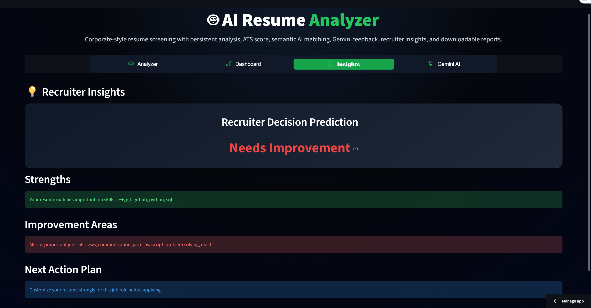

# 🤖 AI Resume Analyzer

An advanced AI-powered ATS Resume Analyzer built with **Streamlit**, **NLP**, **Sentence Transformers**, **Semantic AI Matching**, and **Gemini AI**.

This project simulates how modern Applicant Tracking Systems (ATS) evaluate resumes against job descriptions using keyword analysis, semantic similarity, recruiter-style insights, and AI-generated recommendations.

---

## 🌐 Live Demo

[🚀 Open Live App](https://ai-resume-analyzer-wvgqjxnf3mzf4zes5irkrw.streamlit.app/)

---

## 🚀 Features

- ✅ ATS Resume Scoring
- ✅ Semantic AI Matching
- ✅ Resume Skill Extraction
- ✅ Recruiter Insights
- ✅ Gemini AI Resume Feedback
- ✅ Interactive Analytics Dashboard
- ✅ PDF ATS Report Generation
- ✅ Multi-format Resume Upload (PDF, DOCX, TXT)
- ✅ Persistent Resume Session
- ✅ Remove & Re-upload Resume System

---

## 🧠 Core Functionalities

### 📄 Resume Parsing

Supports the following formats:

- PDF
- DOCX
- TXT

### 🎯 ATS Match Scoring

- Keyword Matching
- Semantic Similarity Matching
- Resume Quality Analysis
- Achievement Score Calculation

### 📊 Analytics Dashboard

- ATS Score Visualization
- Skill Match Distribution
- Score Breakdown Charts
- Recruiter Analytics

### 💡 Recruiter Insights

- Resume Strength Analysis
- Missing Skills Detection
- Recruiter Decision Prediction
- Resume Improvement Suggestions

### ✨ Gemini AI Resume Coach

Generates personalized feedback including:

- Strengths & Weaknesses
- Missing Keywords
- ATS Optimization Suggestions
- Improved Resume Summary
- Better Project Bullet Points
- Final Recruiter Advice

### 📥 PDF ATS Report

Download a professional ATS analysis report containing:

- ATS Score
- Skill Analysis
- Recruiter Insights
- Gemini AI Feedback

---

## 🛠️ Tech Stack

| Category | Technology |
|---|---|
| Frontend | Streamlit |
| AI / NLP | Sentence Transformers, Gemini AI |
| ML | Scikit-learn |
| Visualization | Plotly |
| Data | Pandas |
| Resume Parsing | pdfplumber, python-docx |
| Report Generation | ReportLab |
| Language | Python |

---

## 📸 Screenshots

### 🏠 Analyzer Interface


### 📊 ATS Dashboard


### 💡 Recruiter Insights



### ✨ Gemini AI Feedback


---

## ⚙️ Installation

**1. Clone the repository**

```bash
git clone https://github.com/ramakrishnareddy2112/ai-resume-analyzer.git
cd ai-resume-analyzer
```

**2. Install dependencies**

```bash
pip install -r requirements.txt
```

**3. Run the app**

```bash
streamlit run app/app.py
```

---

## 🔑 Gemini API Setup

Create the secrets file:

```bash
mkdir -p .streamlit
```

Add your API key to `.streamlit/secrets.toml`:

```toml
GEMINI_API_KEY = "YOUR_API_KEY_HERE"
```

> **Note:** Never commit your `secrets.toml` file to GitHub. Add it to `.gitignore`.

---

## 📁 Project Structure

```
ai-resume-analyzer/
├── app/
│   └── app.py
├── screenshots/
│   ├── Analyzer 1.png
│   ├── Analyzer 2.png
│   └── ...
├── .streamlit/
│   └── secrets.toml        # (not committed to Git)
├── requirements.txt
└── README.md
```

---

## 📈 Learning Outcomes

This project demonstrates:

- Natural Language Processing (NLP)
- Semantic Similarity with Sentence Transformers
- Gemini AI / Generative AI Integration
- Resume Parsing (PDF, DOCX, TXT)
- ATS System Simulation
- Data Visualization with Plotly
- PDF Report Automation with ReportLab
- Streamlit App Development

---

## 🎯 Future Improvements

- [ ] User Authentication
- [ ] Resume History Tracking
- [ ] AI Resume Builder
- [ ] Job Recommendation System
- [ ] Resume Classification
- [ ] Cloud Database Integration
- [ ] Multi-Resume Comparison

---

## 👨‍💻 Author

**Pothamsetti Venkata Rama Krishna Reddy**

[](https://github.com/ramakrishnareddy2112)

---

## ⭐ Support

If you found this project helpful, please give it a ⭐ on [GitHub](https://github.com/ramakrishnareddy2112) — it means a lot!

---

## 📄 License

This project is open source and available under the [MIT License](LICENSE).
